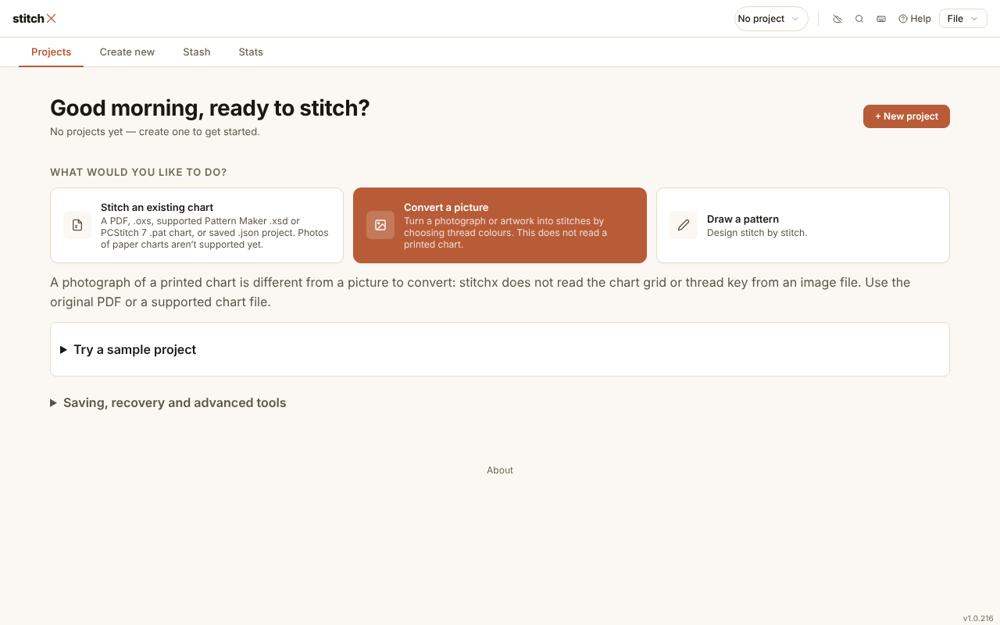
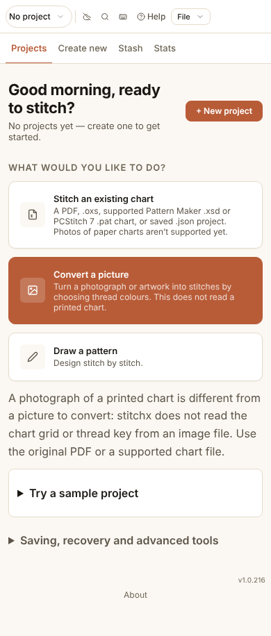
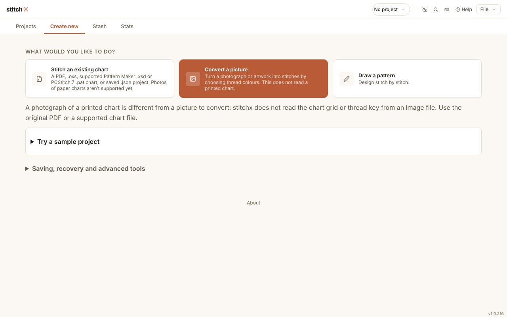
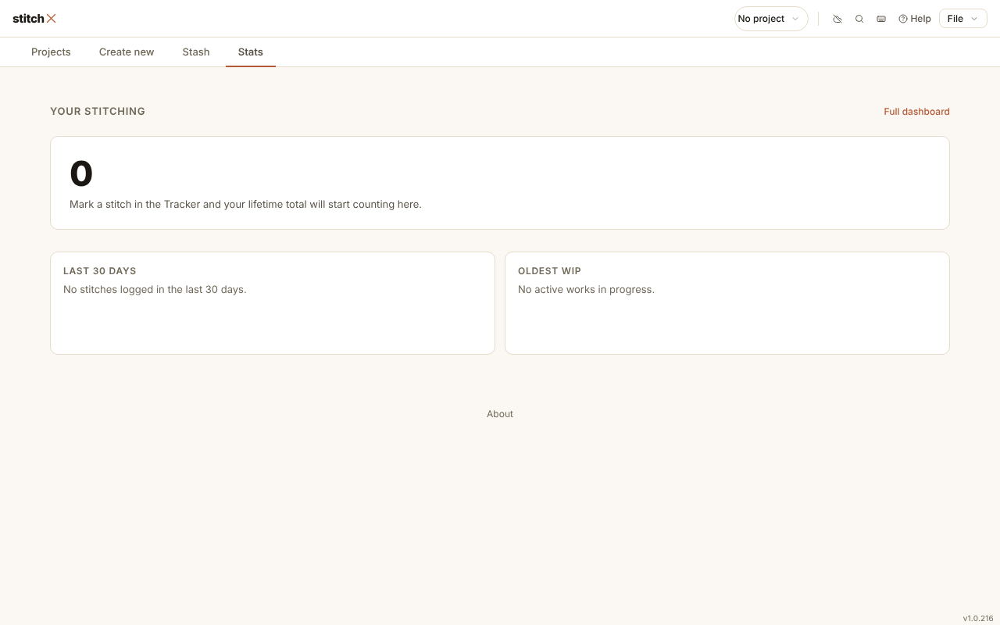
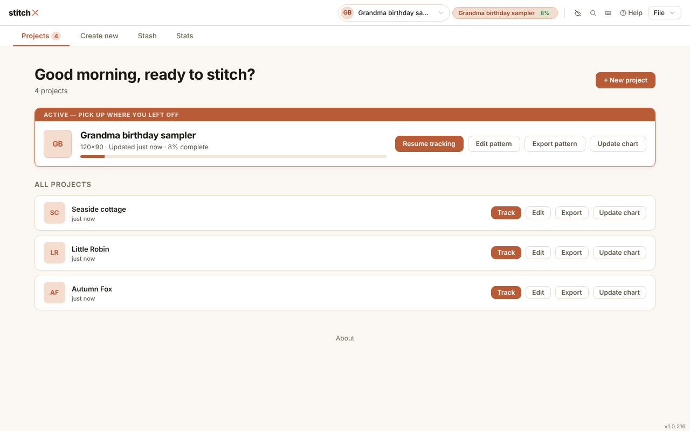
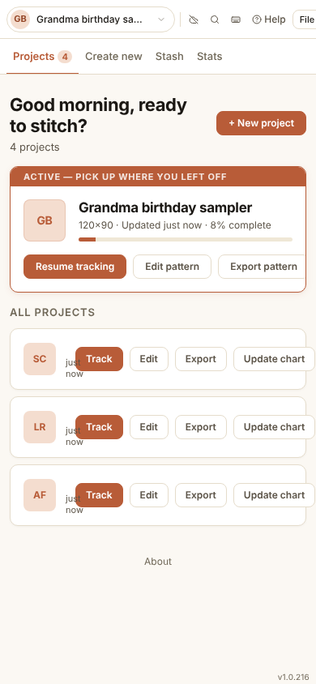

# Home page — new-user walkthrough

> **Phase 1 of 2.** A walkthrough of the current `/home` page
> ([home.html](../../home.html) + [home-app.js](../../home-app.js), v1.0.216)
> from the point of view of people who have never used stitchx, plus one
> returning user. Phase 2 is three redesign proposals:
> [../home-redesign-proposals.md](../home-redesign-proposals.md).

## Method

The real page was served locally (`node serve.js`) and driven with Playwright
in a clean browser profile, at desktop (1280 × 800) and phone (390 × 844)
widths. Each tab was opened and each first-visit control clicked. For the
returning-user pass, four projects were saved through `ProjectStorage.save`
(8 %, 42 %, 100 % and 0 % complete) and the page reloaded.

Screenshots from the run are in this folder.

| | |
|---|---|
|  |  |
| 01 — first visit, desktop | 02 — first visit, phone |
|  |  |
| 03 — after clicking "+ New project" | 04 — Stats tab with no data |
|  |  |
| 05 — returning user, desktop | 06 — returning user, phone |

## Personas

- **Maya** bought a PDF pattern on Etsy and wants to tick off stitches on her
  tablet instead of a highlighter on paper.
- **Tom** wants to turn a photo of his dog into a pattern for a gift.
- **Jo** has used stitchx for a few months, has four projects, and mostly
  opens it on her phone to carry on stitching.

## Walkthrough

### Maya — "I have a pattern I bought"

1. **Lands on the page.** The first words are *"Good morning, ready to stitch?"*
   and *"No projects yet — create one to get started."* Nothing says what
   stitchx is, that it is free, that it needs no account, or that her files
   stay on her device. On a phone the logo isn't shown at all, so the page has
   no name. *(F1, F2)*
2. **Looks for where to start.** There are two candidates: an orange
   **+ New project** button top right, and three tiles under *"What would you
   like to do?"*. She clicks the orange button because it looks primary. The
   greeting disappears, the **Create new** tab lights up, and the same three
   tiles are shown again. From her point of view the button did nothing.
   *(F3, F4 — screenshot 03)*
3. **Reads the tiles.** The middle tile, **Convert a picture**, is filled
   terracotta and looks selected. The first tile, **Stitch an existing chart**,
   is the one she needs, but its description is a list of file formats:
   *"A PDF, .oxs, supported Pattern Maker .xsd or PCStitch 7 .pat chart, or
   saved .json project."* Her pattern is "a PDF from Etsy"; she has to work out
   that this is the right tile from the extension list. *(F5, F7)*
4. **Reads the warnings.** Three separate places tell her that photos of
   printed charts are not supported: tile 1, tile 2, and a paragraph below the
   tiles that is set in *larger type than the tiles themselves*. She hasn't
   done anything yet and is already being told what not to do. *(F6)*
5. **Wonders whether to try it first.** *"Try a sample project"* is a
   collapsed disclosure. Opened, it is an 8 × 8 grid of letters with three
   thread buttons, a practice widget rather than the real Stitch Tracker, and it
   ends by sending her back up the page: *"Use Stitch an existing chart above."*
   *(F8)*
6. **Opens "Saving, recovery and advanced tools".** It talks about Clean-up,
   Adjust image, *Change symbol*, and *Materials & Output > Export > Format &
   settings*, none of which she has seen. The one line she wanted, that her
   work saves automatically on this device, is buried in here. *(F9)*
7. **Scans the header.** A *"No project"* dropdown, three icons without
   labels (a crossed-out cloud, a magnifier, a keyboard), *Help*, and a *File*
   menu. None of these mean anything on a first visit. *(F10)*

### Tom — "I want to turn a photo into a pattern"

1. Tom's path is clearer: **Convert a picture** is the highlighted tile. But
   the tile's copy ends with *"This does not read a printed chart"*, and the
   paragraph below repeats it. Tom has no printed chart; the warning is noise
   for him. *(F6)*
2. Before choosing, he clicks **Stash** and **Stats** to see what else the
   app does. Stash is one sentence and a button (*"Your stash is empty… Open
   Stash Manager"*). Stats is a giant **0** and two empty cards. Neither
   explains what they are *for*, and both point to another page that does the
   same job ("Stash Manager", "Full dashboard"). *(F11 — screenshot 04)*
3. The words *Tracker*, *Creator* and *Stash Manager* appear in copy without
   ever being introduced, so he doesn't build a picture of how the parts of
   the app fit together. *(F1)*

### Jo — returning user with four projects, on her phone

1. **Desktop first.** The page shows the active project in **three** places:
   the header project switcher, a second header chip with *"8%"*, and the big
   *"Active — pick up where you left off"* card. *(F16)*
2. **The project list is a wall of buttons.** Every row has **Track**,
   **Edit**, **Export** and **Update chart**; the active card has four more.
   With 8 projects that is 36 buttons. *Update chart* (re-importing a
   corrected chart, a rare power feature) gets the same weight as Edit.
   *(F12)*
3. **Rows don't show progress.** Jo's 100 % finished *Little Robin*, 42 %
   *Autumn Fox* and untouched *Seaside cottage* all read just *"just now"*: no
   percentage, no size, no bar. Each row has initials in a square, not a picture
   of the pattern. `projectPct()` needs `p.pattern`, and the size comes from
   `p.settings`. The metadata rows returned by `listProjects()` carry neither,
   so these rows never show progress or size. The rows *do* already carry
   `pct`, `dimensions` and a `thumbnail` field
   ([project-storage.js](../../project-storage.js), the meta builder near
   line 251), so this is a quick fix whichever design is chosen. *(F13)*
4. **Older projects vanish.** `ProjectsList` shows `projects.slice(0, 8)`
   with no "Show all" link, so a ninth project silently disappears from Home.
   *(F14)*
5. **On her phone** (screenshot 06) the row buttons sit on top of the project
   names (only *"just now"* peeks out), the active card's **Update chart** is
   pushed off the right edge, and the header's **File** menu is clipped. The
   page doesn't scroll sideways; the overflow is cut off instead. *(F15)*

## Findings

| # | Finding | Who it hurts | Severity |
|---|---|---|---|
| F1 | The page never says what stitchx is, that it's free and needs no account, or that work stays on the device. The three tools are named but never introduced. Phone hides the logo. | New | High |
| F2 | The first-visit greeting ("ready to stitch?") assumes a returning user. | New | Low |
| F3 | Two competing start controls. "+ New project" switches to a tab that shows the same tiles, so on first visit it appears to do nothing. | New | High |
| F4 | Tab/content mismatch: an empty **Projects** tab shows creation tiles; **Create new** shows the same tiles. | New | Medium |
| F5 | The main choice is framed in file-format terms (.oxs, .xsd, .pat, .json) rather than in the user's terms ("a pattern I bought" vs "a photo"). | New | High |
| F6 | The "photos of paper charts aren't supported" warning appears three times, once in larger type than the tiles. | New | Medium |
| F7 | The middle tile is filled terracotta and reads as "selected"; nothing explains why it's emphasised. | New | Low |
| F8 | The sample is collapsed, is a toy rather than the real Tracker, and ends by sending the user back up the page. | New | Medium |
| F9 | Advanced-tool jargon on first visit; the auto-save reassurance is buried inside it. | New | Medium |
| F10 | Header noise for a new user: "No project" dropdown, three unlabelled icons, File menu; no plain navigation to Stash or Stats pages. | New | Medium |
| F11 | Stash and Stats tabs are thin empty states that duplicate their full pages ("Stash" vs "Stash Manager", "Stats" vs "Full dashboard"). | Both | Medium |
| F12 | Four equal-ish buttons per project row; rare actions (Update chart, Export) are given the same weight as common ones. | Returning | High |
| F13 | Project rows show no progress, size or picture, so finished, in-progress and unstarted projects look the same. | Returning | High |
| F14 | Home shows at most 8 projects and gives no "show all" link. | Returning | Medium |
| F15 | Phone layout: buttons overlap project names, actions are cut off, header File menu is clipped. | Returning | High |
| F16 | The active project is shown three times (switcher, % chip, Active card). | Returning | Low |

## What the redesigns need to do

1. **Say what stitchx is** in one sentence, with the privacy promise (free,
   no account, stays on this device) up front.
2. **Ask about intent in the user's words**, with one path per intent and
   one primary way in, not two.
3. **Warn once, at the moment it matters**, not three times up front.
4. **Make "carry on" the obvious action** for returning users: one primary
   action per project, the rest behind a "More" menu.
5. **Show progress and a picture** for every project, and never silently
   drop projects.
6. **Stop duplicating** the Stash Manager and Stats pages as thin tabs:
   either summarise them usefully or link to them.
7. **Work on a phone** first, since returning users mostly stitch on one.
