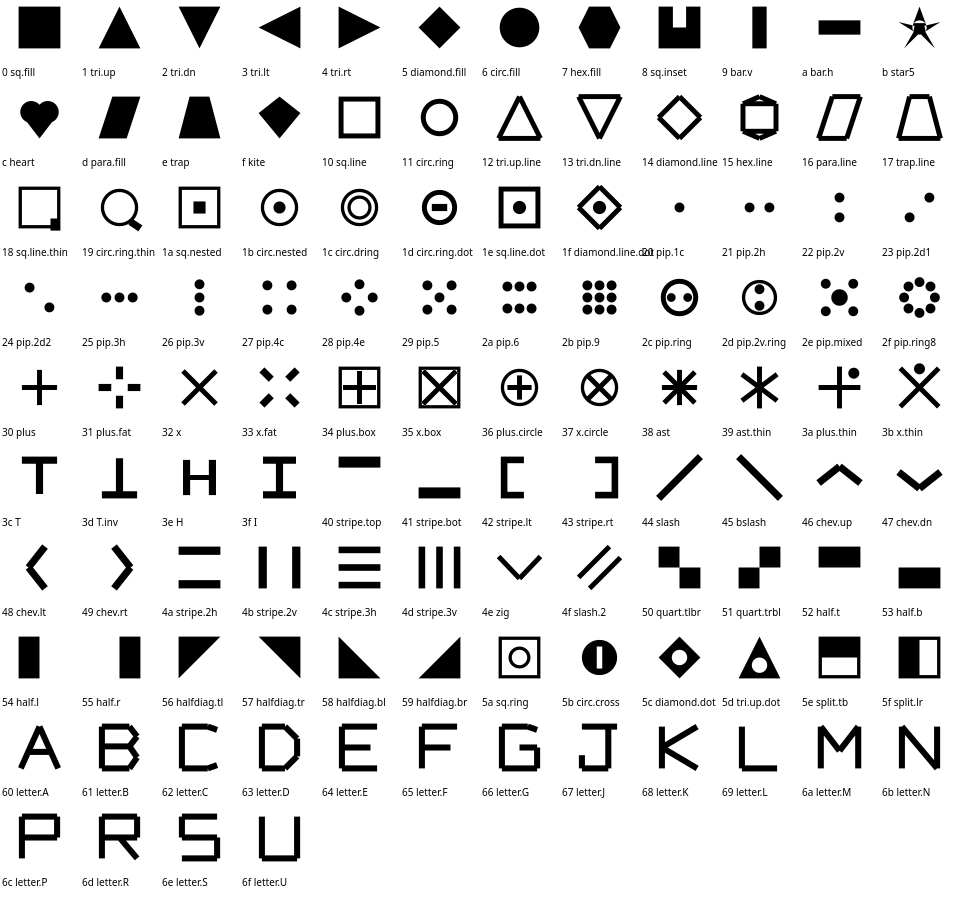
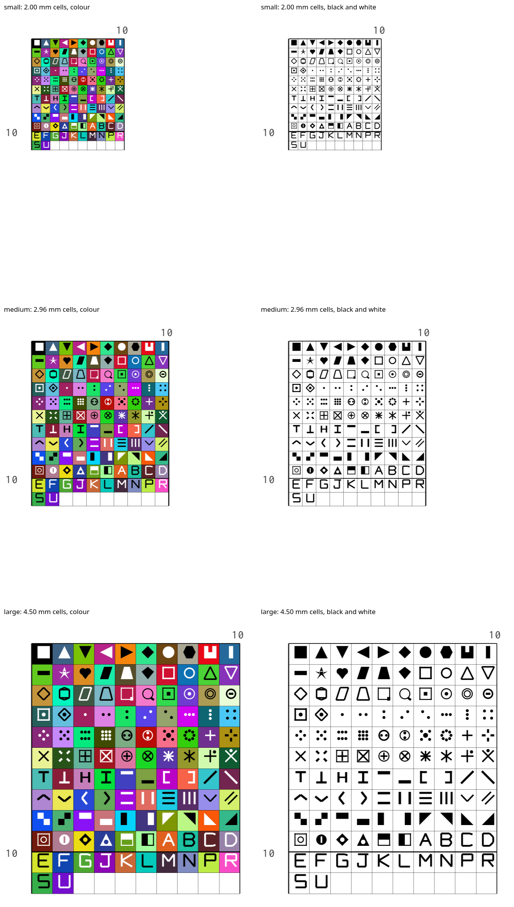

# PDF symbol uniqueness audit

Checked 16 October 2026 against baseline `352052f4ada5e6e6fb1edcb004c0345e90b2d6cd`.
The initial `work` branch was clean. No unrelated changes were present.

## Reproduction and behaviour

Before editing, 100 distinct numeric thread IDs produced 96 distinct codepoints:
`1096/1000`, `1097/1001`, `1098/1002`, `1099/1003` shared glyphs.
All four baseline PDF/layout/font test suites passed (41 tests), including a test
that explicitly endorsed wrapping. The actual baseline worker PDF likewise
contained only 96 unique chart symbols for those 100 threads.

The worker now counts used full-cell IDs, filters and deduplicates the palette,
then calls one deterministic assignment shared by the full legend, both chart
modes and each page's mini legend. Cover/info colour counts use that same used
palette. Numeric solids still precede lexical blends. A blend consumes one
symbol; its constituent threads do not consume symbols unless used separately.
Reserved empty IDs, null entries and unused palette entries consume none.
A used ID missing from the palette is an error. Repeated references to a thread
share its one assignment. Screen symbol overrides remain independent of the PDF
font, matching the existing documented behaviour.

The verified font capacity is **112**. Used palettes above 112 fail explicitly,
with the required count and limit in the error message. The worker checks that
the embedded font contains every assigned codepoint and propagates drawing
errors from charts, legends and summaries. It no longer catches an error and
silently leaves out the symbol.

## Font review

Sixteen block letters were appended at U+E060–U+E06F. All 96 legacy codepoints
and glyph indices retain their original positions; 79 legacy outlines are
unchanged, guarded by a hash captured from the baseline font.

Seventeen ambiguous shapes were repaired in place:

| Legacy offsets (hex, relative to U+E000) | Repair |
| --- | --- |
| 07 | Angular hexagon, distinguishable from the disc |
| 08 | Notched square, rather than a slightly smaller filled square |
| 18, 19 | Tails distinguish thin square/ring variants |
| 1D | Dash in ring distinguishes the ring-and-dot variants |
| 1E, 1F, 5C, 5D | Larger interior marks/holes remain visible at small print sizes |
| 2C | Two horizontal pips in ring distinguish the single-pip variants |
| 31, 33 | Separated plus/X arms replace thickness-only variants |
| 39 | Six-spoke asterisk distinguishes the eight-spoke variant |
| 3A, 3B | Offset dots distinguish thin plus/X variants |
| 42, 43 | Brackets replace identical bars distinguished only by position |

Both font readers (opentype.js and fontkit) resolve all 112 characters to real,
non-empty glyphs. Generated TTF and base64 bytes match. Raster comparison at
18/26/38 px rejects blank glyphs and any pair with less than 10% differing ink;
this catches the former near-duplicate shapes. It is a regression guard, not a
claim of universal readability on every printer.



## Actual PDF evidence

These are output from the production worker pipeline, executing locally with
its pinned pdf-lib and fontkit dependencies. Each PDF contains colour and
black-and-white chart sections, all legend pages, cover/info, page summaries
and the chart index. The last colour is a blend (`310+550`).

- [100 colours, Medium](100-medium.pdf)
- [112 colours, Small](112-small.pdf)
- [112 colours, Medium](112-medium.pdf)
- [112 colours, Large](112-large.pdf)

The actual PDFs were rendered with Poppler at 300 dpi and visually inspected,
including first/last legend pages and every glyph in both chart modes. The
contact sheet crops the actual chart regions without changing their scale.



Reproduce PDF/render evidence with:

```sh
node scripts/verify-pdf-symbols.cjs
```

This writes to `work/pdf-symbols/` and requires devDependencies and `pdftoppm`.
PDF creation timestamps make byte hashes vary when rerunning.

The original and changed workers were also compared on a 12-thread fixture:
all parsed text strings, positions, widths and heights were identical. This
checks layout preservation; entire PDF bytes necessarily change with the font.
No chart geometry, pagination, grid, overlap, font size or theme rules changed.

## Automated validation

- Full `npm test`: **337 suites / 4,564 tests passed; 1 suite / 1 test failed**;
  the existing snapshot passed.
- The failure is `tests/compiledUpToDate.test.js`, which launches a build check
  with `spawnSync`. A direct reproduction in this sandbox returns
  `{status: 0, error: 'EPERM', stdout: '', stderr: ''}`. Its isolated rerun fails
  the same way. The direct `node build-runtime-js.js --check` command passes:
  `compiled/ is up to date`. The unrelated test was not changed or disabled.
- PDF-specific tests pass, including existing Pattern Keeper primitive, theme,
  knot, worker-transfer and CSP regression checks.
- Behaviour coverage includes 0/1, 95/96/97, 99/100, 111/112/113/114/200 entries;
  blending, reversed palettes, empty/sentinel entries, 200-entry mostly-unused
  palettes, repeated references, screen overrides, missing palette IDs, missing
  embedded glyphs, drawing errors and overlapping multi-page charts.
- Actual PDFs are parsed with PDF.js to check all chart symbols, each full
  legend's glyph-to-thread relation and mini-legend assignments. Tests inspect
  the actual embedded font stream, its full byte identity and font dictionary,
  and verify absence of object streams.
- The font still embeds with `subset:false`; save still uses
  `useObjectStreams:false`. The font family and legacy cmap/GID positions remain.
- `node build-creator-bundle.js` regenerated both affected bundles.
- Terminology lint, direct runtime bundle freshness check and `git diff --check`
  pass. CSS token lint exits successfully with 13 existing advisory findings in
  unchanged `styles.css`.

## Compatibility limitations

**Pattern Keeper itself is unavailable in this environment. No Android/device
import, colour identification or stitch-highlighting check was performed.**
The automated checks above verify the available PDF compatibility primitives;
they do not certify the new glyphs or repaired shapes in Pattern Keeper.
Physical paper printing was also unavailable.

Poppler emits `Mismatch between font type and embedded font file` while reading
both the untouched baseline export and these PDFs. The generated font is an
OpenType/CFF sfnt despite the `.ttf` filename; the existing pdf-lib embedding path
is retained. PDF.js parses the exported text and Poppler renders all symbols,
but that pre-existing container warning remains a compatibility risk requiring
manual Pattern Keeper review. This change does not claim to resolve it.

The scope is symbol assignment for the existing full-cell chart renderer. No new
fractional-stitch, backstitch or Pattern Keeper knot support is claimed; the
existing Workshop-only knot behaviour is covered by its regression tests.

The separate bug-hunting pass found and fixed missing-palette symbol omission,
swallowed drawing failures, unused/duplicate palette capacity consumption,
inconsistent used-colour summaries, and the lookalikes listed above. It also
identified the pre-existing font-container warning and unavailable checks above.
