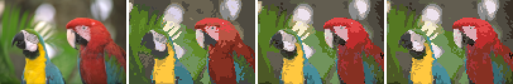
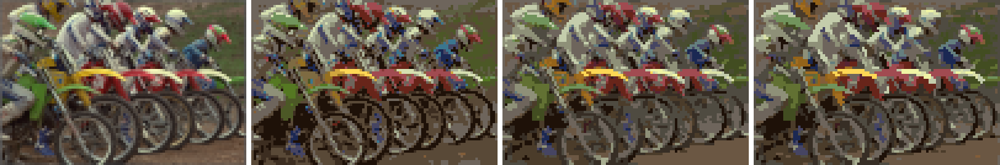

# Photo-to-chart accuracy review

22 October 2026. Covers the Convert step: `creator/generate.js`, `generate-worker.js`,
`colour-utils.js`, the defaults in `user-prefs.js` and `creator/useCreatorState.js`, and
the controls in `creator/Sidebar.js`. No app code is changed by this report.

## Summary

1. **Stitch cleanup does almost nothing on photos.** The "Protect fine details" edge map
   covers about half of every photo (51% of stitches on average), and any small patch that
   touches it is left alone. As a result, *Reduce confetti* (0, 2 or 3), *Cleanup strength*
   (Gentle, Balanced or Thorough) and *Fewer confetti stitches in shading* changed confetti
   by less than 0.1 percentage point in every test. A new user's photo chart has 6.7% confetti
   stitches; 12% of stitches sit in patches of three or fewer.
2. **Boundaries are darkened by the way the photo is shrunk.** The browser averages pixel
   values as stored (gamma-encoded) rather than as light. Where a stitch covers a bright
   and a dark area, it comes out too dark. On detailed photos, up to 26% of stitches are off by
   more than ΔE 3 before any thread is chosen, and up to ΔE 21 at the worst stitch.
3. **The Photo preset's thread budget is too tight for skin and small subjects.** "20 threads"
   gives about 17 in practice, because palette refinement drops near-duplicates. The threads go
   to big areas (backgrounds, clothes). On the astronaut portrait, the face is drawn mostly in
   DMC 613 (a grey-beige), which is why faces look grey. At 24 threads with light-correct
   shrinking, face error falls by 20% (ΔE 6.2 to 4.9).
4. **Several settings add noise or do nothing:** *Strong* shading is worse than *Balanced* on
   every measure. *Pattern blend* on photos more than doubles confetti with no accuracy gain.
   *Soften grainy photos* blurs edges (edge error +2 to +3 ΔE), because it runs after the
   photo is already averaged down to stitch size. The default *Min stitches per colour* of 6 is
   redundant with the automatic rare-colour pass. *Keep look-alike colours apart* trades
   accuracy for legibility (+0.6 ΔE, +54% patches).
5. **Some control descriptions don't match behaviour.** *Reduce confetti* (default 2) silently
   overrides *Cleanup strength*'s cluster size. Neither control's description gives the real
   sizes it removes, which reach up to 3× the stated size in flat areas.

The best single change is to stop dilating the edge map. Confetti drops by 36 to 42% for
almost no accuracy cost. The best default change is 24 threads for photos with light-correct
shrinking. Both are detailed under [Recommendations](#recommendations).

## How this was measured

The real worker pipeline (`generate-worker.js` plus `colour-utils.js`) was loaded into Node
and run on ten standard test photos: six from the Kodak lossless suite and four from
scikit-image (portrait, cat, coffee, rocket). Each photo was converted at the default
100-stitch long side under 40 setting combinations. The scripts are in
[scripts/conversion-accuracy/](../scripts/conversion-accuracy/README.md).

Each chart is scored against the photo itself: for every stitch, the light-correct average
of the photo pixels it covers.

| Measure | What it means |
|---|---|
| Stitch error | Mean CIEDE2000 ΔE per stitch. Roughly: 1 is just noticeable, 2 to 3 is visible side by side, over 5 is a clearly different colour. |
| Viewed error | The same after blurring chart and photo by one stitch, roughly how a chart reads from arm's length. This is fair to shading, which deliberately mixes colours. |
| Boundary error | Stitch error on strong boundaries only (outlines, edges of features). |
| Confetti | Stitches with no same-colour neighbour, using the app's own `analyzeConfetti`. |
| Small patches | Stitches in same-colour patches of 1 to 3. |
| Patches per 100 | Separate same-colour patches per 100 stitches. Fewer means fewer thread starts. |
| Threads, symbols | Distinct threads to buy, and chart symbols (each blend is one extra symbol). |

Caveats: Node shrinks with an exact area average rather than the browser's halving chain,
which is close but not identical. Ten photos is a small set, though every finding below held
across all ten. The thread colours themselves are screen approximations (see
[dmc-colour-audit.md](dmc-colour-audit.md)), which puts a floor under any "accuracy" number.

## The pipeline today

```
photo (up to 2000 x 2000)
  -> brightness / contrast / saturation (canvas filter)
  -> [optional] pre-sharpen at 8x grid size
  -> shrink to grid by repeated halving (gamma-space averaging)        <- finding 2
  -> [optional] Soften: median / Gaussian, at stitch size              <- finding 4
  -> choose palette: k-means on DMC, prune near-duplicates, add small distinct colours
  -> match each stitch: nearest thread, or Atkinson / Bayer shading, optional blends
  -> fold rare colours: user minimum (no contrast guard), then automatic 0.5% (guarded)
  -> fold anti-aliased edge shades into their neighbours (Stitch Cleanup on)
  -> remove small patches, skipping any that touch the edge map        <- finding 1
  -> [optional] keep look-alike neighbours apart
  -> enforce thread maximum
```

The palette stage is in good shape. It works in CIEDE2000 throughout, prunes noise-driven
duplicates, and adds small but clearly different features like catchlights. Earlier audits
already fixed most of its problems. The losses are mostly before it (shrinking) and after it
(cleanup).

## What a new user gets

On upload, `examinePicture` guesses the picture type and applies its preset over the
Preferences defaults. For a photo:

| Setting | Effective default | Source |
|---|---|---|
| Size | 100 stitches on the long side | `INITIAL_LONG_SIDE_STITCHES` |
| Threads (max) | 20 (about 17 actually used) | Photo preset |
| Shading | Smooth blend, Subtle (Atkinson at 50%) | Photo preset |
| Blends | On (about 29 symbols for 17 threads) | Photo preset |
| Fewer confetti stitches in shading | On | Preferences |
| Min stitches per colour | 6 | Preferences |
| Reduce confetti | 2 | Preferences |
| Stitch Cleanup | On, Balanced | Photo preset / Preferences |
| Protect fine details | On | Preferences |
| Soften, brightness, contrast, saturation | Off / 0 | built in |

The preset is a clear improvement on the plain Preferences defaults (15 threads, no shading),
which score worst of everything tested for photos: stitch error 6.30 against 5.49. Shading
matters most on faces: with shading off, the astronaut's face is twice as far off (ΔE 11.6
against 6.2). Those Preferences values were
chosen so logos stay clean (see the comment in `user-prefs.js`), and they still apply
whenever the picture-type guess is turned off.

## Findings

### 1. Cleanup is blocked on photos

`removeOrphanStitches` skips any small patch with even one stitch on the edge map
(`generateEdgeMap`: Canny edges, plus colour edges, then dilated by one stitch). At stitch
size, a photo is mostly edges:

| Photo | Edge map coverage | Before dilation | Mean "detail" score |
|---|---|---|---|
| kodim05 (motorbikes) | 76% | 43% | 0.98 |
| kodim23 (parrots) | 63% | 35% | 0.91 |
| astronaut (portrait) | 59% | 29% | 0.93 |
| rocket | 31% | 13% | 0.46 |
| **mean of 10** | **51%** | **25%** | **0.82** |

The saliency ("detail") map is also near its ceiling on most photos. Its divisor is capped
at `SALIENCY_NORM_HI`, a 40-grey step, which almost every neighbouring pair of stitches in a
photo exceeds. Both features that are meant to treat flat areas differently scale by
`1 - saliency`: the size multiplier in orphan removal and the confetti penalty in Atkinson
shading. Both therefore act as if there were no flat areas.

Effect of each cleanup control, everything else at the default:

| Change from default | Stitch error | Boundary error | Confetti | Small patches |
|---|---|---|---|---|
| (default) | 5.49 | 7.46 | 6.67% | 12.38% |
| Reduce confetti 0 | 5.51 | 7.48 | 6.67% | 12.07% |
| Reduce confetti 3 | 5.50 | 7.47 | 6.66% | 12.05% |
| Cleanup strength Gentle | 5.48 | 7.46 | 6.67% | 12.47% |
| Cleanup strength Thorough | 5.49 | 7.46 | 6.67% | 12.36% |
| Fewer confetti in shading off | 5.45 | 7.44 | 6.67% | 12.29% |
| Saliency divisor 3x higher | 5.46 | 7.39 | 6.54% | 11.94% |
| **Edge map not dilated** | 5.58 | 7.71 | **3.86%** | **8.11%** |
| **No edge map, contrast guard kept** | 5.91 | 9.04 | **0.17%** | **1.58%** |
| Protect fine details off | 5.92 | 9.09 | 0.12% | 1.49% |
| Stitch Cleanup off, confetti 0 | 4.94 | 6.58 | 12.30% | 23.11% |

The last row shows that the cleanup which does run (the edge-shade fold) halves confetti. It
also shows that tidying costs accuracy, which is expected: a confetti stitch is often the
closest colour. The edge map is the switch that blocks the rest. Without dilation, the
remaining edges still protect outlines while letting flat areas be tidied.
`ORPHAN_CONTRAST_GUARD_DE` (30) already protects catchlights and pupils on its own.

### 2. Shrinking in gamma space darkens boundaries

`prescaleForGrid` and the final `drawImage` average stored sRGB values. Averaging a white and a
black pixel gives 128 (about 22% of the light) instead of 188 (50%). Thin bright details and
mixed-colour boundaries therefore come out too dark and muddy, before any thread is chosen.

Measured on the shrunk image alone, gamma-space against light-correct:

| Photo | Mean ΔE | On boundaries | Stitches off by more than 3 | Worst |
|---|---|---|---|---|
| kodim05 | 2.28 | 3.21 | 26.5% | 21.2 |
| astronaut | 1.11 | 2.73 | 11.8% | 21.4 |
| kodim07 | 1.03 | 1.70 | 10.0% | 11.7 |
| coffee | 0.83 | 2.69 | 6.9% | 19.9 |
| chelsea | 0.41 | 1.23 | 0.6% | 6.0 |

After the full pipeline, light-correct shrinking lowers mean boundary error by 4% (7.46 to
7.16). The gain is larger on faces (0.9 ΔE on the astronaut's face), because skin next to hair
and eyes is exactly the mixed-boundary case. It costs one extra full-resolution pass:
linearise, average, re-encode. That pass can be done on an `ImageData` at the 2×-grid stage
that `prescaleForGrid` already produces.

Diffusing shading error in linear light instead of gamma made no measurable difference at
Subtle strength (stitch error 5.49 against 5.52), so it is not worth the change.

### 3. Thread budget and palette

| Threads (max) | Threads used | Stitch error | Viewed error | Confetti | Symbols |
|---|---|---|---|---|---|
| 15 | 14.1 | 5.76 | 3.80 | 6.19% | 24.8 |
| 20 (default) | 16.7 | 5.49 | 3.51 | 6.67% | 29.2 |
| 24 | 18.4 | 5.27 | 3.35 | 7.39% | 32.7 |
| 30 | 19.2 | 5.21 | 3.31 | 7.41% | 34.2 |
| 40 | 19.3 | 5.30 | 3.37 | 7.09% | 35.1 |

Palette refinement treats the maximum as a cap, not a quota, so raising it to 30 costs only
about 2.5 more threads. Above 30, it stops helping. The palette is chosen by area (k-means
weights every pixel equally), so small but important subjects such as faces get whatever is
left. On the astronaut, the face's main thread at 20 threads is DMC 613 Drab Brown Very Light.
At 24 threads with light-correct shrinking, the face gains DMC 840 and its error falls from
6.2 to 4.9.

Blends improve accuracy modestly (stitch error 5.96 without, 5.49 with) but add about 12
chart symbols for 17 threads. That is within the printed chart's 112-symbol limit, but
harder to read. Keeping them on for photos is reasonable.

### 4. Settings that add noise or do nothing

| Setting | Measured effect on photos | Verdict |
|---|---|---|
| Reduce confetti 1 to 3 | No change (blocked by edge map, finding 1) | Inert today. Useful once finding 1 is fixed. |
| Cleanup strength | No change. Also overridden by Reduce confetti when that is above 0. | Inert. Merge with Reduce confetti. |
| Fewer confetti stitches in shading | No change (saliency saturated) | Inert. Remove or fix saliency. |
| Min stitches per colour = 6 | No change in any measure. At 100 stitches, the automatic pass already folds colours under 15 stitches, with a contrast guard. The user minimum has no guard, so the only extra thing it can do is remove a deliberate catchlight under 6 stitches. | Default to 0 (Off). |
| Shading Strong | Worse than Balanced on every measure: stitch error 7.73 against 6.10, viewed 4.35 against 3.54, more confetti | Remove, or cap at Balanced. |
| Shading Balanced | Viewed error 3.54 against Subtle's 3.51, with +0.8 points confetti | Subtle is the better default. |
| Pattern blend (Bayer) on photos | Confetti 15.6% (more than double), no accuracy gain over Smooth blend | Keep for graphics. Never suggest for photos. |
| Soften grainy photos | Stitch error +0.5 to +0.7, boundary error +2.2 to +3.1, confetti down 2 to 3 points | Runs at stitch size, after shrinking has already averaged grain away. Move it before shrinking, or remove it. |
| Keep look-alike colours apart | Stitch error +0.6, patches +54% | A legibility tool, not an accuracy one. Fine off by default; its help text should say it moves colours. |
| Blends | Helps accuracy (−0.47) at about +12 symbols | Keep. |

Code paths that exist but are unreachable or inconsistent:

- `doRiemersma` (Hilbert-curve shading) is wired through both pipelines but the UI cannot
  select it. It measured slightly fewer confetti stitches than Subtle (5.85% against 6.67%)
  with slightly worse error. It is not worth exposing, so it is dead code.
- The stash variation gallery (`generateGallery` in `useCreatorState.js`) draws the photo
  straight to grid size, without `prescaleForGrid`, high smoothing quality, pre-sharpen or the
  minimum-stitches setting. Its thumbnails are noisier than the chart the user then gets.
- The live preview is capped at 200 × 200 stitches. Cleanup sizes are counted in stitches,
  so for larger charts the preview's cleanup is stronger than the real one.
- The experimental import wizard (`useImportWizard.js`) defaults to 30 colours with shading
  on. That disagrees with the Convert defaults, though it is behind a preference.

### 5. Descriptions that don't match behaviour

- *Cleanup strength* tooltips say "Keeps 2-stitch clusters", "Removes 3-stitch clusters" and
  "Removes up to 5-stitch clusters". The code (`STRENGTH_MAP`) uses 2, 4 and 6, multiplied by
  up to 2× to 4× in flat areas. Whenever *Reduce confetti* is above 0 (the default is 2), its
  value replaces the strength's size, so the strength only changes the flat-area multiplier.
- *Reduce confetti* level 1 says it "targets groups of exactly 1 stitch". In flat areas
  (saliency 0) it removes up to 3 with Balanced strength. Level 2's "1 to 2 stitches" can be up
  to 6.
- Two controls (*Reduce confetti*, and *Stitch Cleanup* with *Cleanup strength*) drive one
  stage, plus a third (*Fewer confetti stitches in shading*) that measurably does nothing.
  This makes the Clean-up section hard to reason about.

### 6. Smaller observations

- **Picture-type guess.** Graphics need 95% of pixels in their top 8 colour groups. Logos
  score 0.97 to 0.99 and photos 0.20 to 0.61. A logo saved as a JPEG at quality 0.7 scores
  0.948 and is treated as a photo, so it gets shading and blends. An illustration with more
  than 8 flat colours always is. A cut-off near 0.85 would leave a wide margin either side.
- **Bayer spread** is a fixed ±16 to ±32 RGB levels (by matrix size) whatever the palette's spacing. With 20
  threads that is noise added to every stitch, even where a thread matches exactly. Scaling
  it by the local distance to the second-nearest thread is the usual fix.
- **Palette snapping order.** `quantizeConstrained` snaps cluster centres to threads greedily
  in cluster order, so a later cluster can lose its best thread to an earlier, smaller one.
  Not measured here; a candidate for a follow-up.
- **Mixed colour measures.** Pixels are assigned in OKLab, centres averaged in CIELAB, and
  threads matched in CIEDE2000. Each step is reasonable, but they can disagree near cluster
  boundaries. Not measured; low priority.

## Recommendations

In order of benefit for effort.

### Defaults (small changes, measured)

| Change | Where | Measured effect |
|---|---|---|
| Stop dilating the edge map for orphan protection (`edgeDilation: 0`) | `runCleanupPipeline` and the worker | Confetti 6.67% to 3.86%, small patches 12.4% to 8.1%; stitch error +0.09 |
| Photo preset: 24 threads | `PICTURE_PRESETS.photo` | Stitch error 5.49 to 5.27, boundary 7.46 to 7.18, about 1.7 more threads, confetti +0.7 points |
| *Min stitches per colour* default 0 | `user-prefs.js` | No measurable change; stops unguarded removal of tiny accents |
| Picture-type graphic cut-off 0.95 to about 0.85 | `guessPictureType` | Compressed logos and many-colour illustrations get the Graphic preset |

Together with light-correct shrinking, these make **Option A** in the table below.

### Pipeline (moderate work)

1. **Shrink in linear light.** Replace the gamma-space halving chain in `prescaleForGrid`
   (and the final `drawImage`) with a light-correct area average. One shared helper is used by
   generate, preview and compare. Boundary error −4% on average, more on faces and
   high-contrast detail.
2. **Move *Soften* before shrinking**, at source resolution, where grain actually exists. Or
   drop it: area-averaging already removes grain at 100 stitches.
3. **Give the palette a reason to serve small subjects.** For example, weight k-means samples
   by saliency, or reserve one or two slots for the largest poorly-served high-saliency region.
   Faces are where users notice colour errors first. Not prototyped.
4. **Recalibrate the saliency map for stitch size**, or drop the features that depend on it.
   This only matters once the edge map no longer blocks cleanup. Raising the divisor 3× alone
   changed nothing.

### Controls (simplify)

- Merge *Reduce confetti* and *Cleanup strength* into one control whose description states the
  real patch sizes it removes.
- Remove *Fewer confetti stitches in shading*, or keep it hidden until saliency is fixed.
- Drop *Strong* shading.
- Make the photo guidance say that *Pattern blend* suits graphics only.
- Say in *Keep look-alike colours apart*'s help that it moves stitches away from their true
  colour.

### Proposed default sets

Both use light-correct shrinking, 24 threads, Subtle shading, blends on and *Min stitches* 0.

| | Stitch error | Viewed error | Boundary error | Confetti | Small patches | Patches per 100 | Threads | Symbols |
|---|---|---|---|---|---|---|---|---|
| Current default | 5.49 | 3.51 | 7.46 | 6.67% | 12.38% | 11.75 | 16.7 | 29.2 |
| **A: accurate** (edge map not dilated, Reduce confetti 2) | **5.43** | 3.54 | **7.34** | 4.27% | 9.09% | 9.03 | 18.0 | 31.5 |
| **B: tidy** (no edge map, contrast guard kept, Reduce confetti 1) | 5.62 | 3.61 | 8.21 | **0.13%** | **5.79%** | **5.59** | 17.9 | 29.9 |

**A** is more accurate than today and has a third fewer confetti stitches. **B** is barely
less accurate overall (+2%) but slightly softer at boundaries (+10%), and has almost no
confetti and half as many patches, so it is much quicker to stitch. I would make A the
default, and offer B as the "easier to stitch" end of a single cleanup slider.

Each image below shows, left to right: the photo at stitch size, the current default,
Option A and Option B.


The current default draws the face grey-beige; A and B give warmer skin and keep the eyes and
mouth.



The current default puts a pink patch on the red parrot's chest. A and B keep the reds
consistent.



This is the most detailed photo, where gamma-space shrinking does the most damage.

## Appendix: full settings sweep

Ten photos, 100 stitches on the long side, one change from the current default per row
(except where stated). Produced by `scripts/conversion-accuracy/sweep-settings.js`.

| Configuration | Stitch error | Viewed error | Boundary error | Confetti | Small patches | Patches per 100 | Colour changes | Symbols | Threads |
|---|---|---|---|---|---|---|---|---|---|
| Default (Photo preset) | 5.49 | 3.51 | 7.46 | 6.67 | 12.38 | 11.75 | 31.0 | 29.2 | 16.7 |
| Preferences only (no guess: 15 threads, no shading) | 6.30 | 4.49 | 8.78 | 3.61 | 6.93 | 7.08 | 24.1 | 13.5 | 13.5 |
| Shading off | 6.16 | 4.27 | 8.73 | 3.71 | 7.15 | 7.30 | 24.8 | 16.2 | 16.2 |
| Shading Balanced | 6.10 | 3.54 | 8.19 | 7.51 | 14.54 | 13.33 | 33.7 | 28.2 | 16.7 |
| Shading Strong | 7.73 | 4.35 | 9.90 | 8.04 | 15.93 | 14.35 | 35.9 | 26.9 | 16.7 |
| Pattern blend (Bayer 4×4) | 6.10 | 3.68 | 8.29 | 15.60 | 21.45 | 20.82 | 40.1 | 30.9 | 16.7 |
| Riemersma (not in UI) | 5.67 | 3.87 | 7.68 | 5.85 | 10.74 | 10.55 | 29.5 | 28.8 | 16.6 |
| Blends off | 5.96 | 3.67 | 8.09 | 5.62 | 11.06 | 10.51 | 30.2 | 16.7 | 16.7 |
| Fewer confetti in shading off | 5.45 | 3.49 | 7.44 | 6.67 | 12.29 | 11.73 | 30.9 | 29.2 | 16.7 |
| Reduce confetti 0 | 5.51 | 3.58 | 7.48 | 6.67 | 12.07 | 11.46 | 30.0 | 29.2 | 16.7 |
| Reduce confetti 3 | 5.50 | 3.55 | 7.47 | 6.66 | 12.05 | 11.52 | 30.3 | 29.1 | 16.7 |
| Stitch Cleanup off, Reduce confetti 0 | 4.94 | 2.94 | 6.58 | 12.30 | 23.11 | 20.28 | 41.8 | 31.5 | 16.7 |
| Strength Gentle | 5.48 | 3.50 | 7.46 | 6.67 | 12.47 | 11.81 | 31.2 | 29.4 | 16.7 |
| Strength Thorough | 5.49 | 3.52 | 7.46 | 6.67 | 12.36 | 11.70 | 30.9 | 29.2 | 16.7 |
| Strength Gentle, Reduce confetti 0 | 5.48 | 3.50 | 7.46 | 6.67 | 12.47 | 11.81 | 31.2 | 29.4 | 16.7 |
| Strength Thorough, Reduce confetti 0 | 5.53 | 3.60 | 7.48 | 6.67 | 12.06 | 11.39 | 29.7 | 29.2 | 16.7 |
| Protect fine details off | 5.92 | 3.91 | 9.09 | 0.12 | 1.49 | 3.24 | 22.5 | 26.6 | 16.6 |
| Min stitches 0 | 5.49 | 3.50 | 7.46 | 6.65 | 12.37 | 11.73 | 31.0 | 29.1 | 16.7 |
| Min stitches 20 | 5.51 | 3.53 | 7.53 | 6.38 | 12.03 | 11.43 | 30.8 | 27.3 | 16.2 |
| Threads 15 | 5.76 | 3.80 | 7.89 | 6.19 | 11.75 | 11.15 | 29.9 | 24.8 | 14.1 |
| Threads 24 | 5.27 | 3.35 | 7.18 | 7.39 | 13.69 | 12.84 | 32.1 | 32.7 | 18.4 |
| Threads 30 | 5.21 | 3.31 | 7.03 | 7.41 | 13.68 | 12.87 | 32.0 | 34.2 | 19.2 |
| Threads 40 | 5.30 | 3.37 | 7.61 | 7.09 | 13.32 | 12.46 | 31.7 | 35.1 | 19.3 |
| Soften, median 1 | 6.00 | 3.97 | 9.62 | 4.40 | 8.44 | 8.57 | 26.7 | 31.5 | 17.3 |
| Soften, Gaussian 1 | 6.20 | 4.02 | 10.56 | 3.33 | 7.08 | 7.25 | 25.8 | 31.6 | 17.1 |
| Keep look-alike colours apart (Standard) | 6.09 | 3.72 | 7.48 | 6.67 | 12.38 | 18.14 | 36.4 | 29.5 | 16.8 |
| No shading, cleanup or minimum (raw) | 5.58 | 3.73 | 7.11 | 6.28 | 11.45 | 11.04 | 29.8 | 16.8 | 16.8 |
| Light-correct shrinking | 5.43 | 3.51 | 7.16 | 6.67 | 12.37 | 11.61 | 30.1 | 29.3 | 16.4 |
| Light-correct shrinking and shading | 5.45 | 3.46 | 7.22 | 6.68 | 12.43 | 11.67 | 30.2 | 30.0 | 16.4 |
| Edge map not dilated | 5.58 | 3.64 | 7.71 | 3.86 | 8.11 | 8.31 | 27.6 | 28.6 | 16.7 |
| No edge map, contrast guard kept | 5.91 | 3.89 | 9.04 | 0.17 | 1.58 | 3.31 | 22.6 | 26.8 | 16.7 |
| No edge map, guard kept, Reduce confetti 1 | 5.75 | 3.66 | 8.50 | 0.13 | 5.62 | 5.39 | 26.3 | 27.9 | 16.7 |

Confetti, small patches and colour changes are percentages. Colour changes are the share of
neighbouring stitch pairs that differ.
