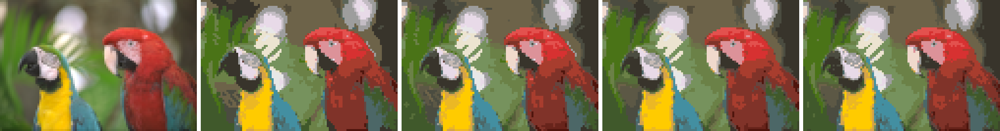
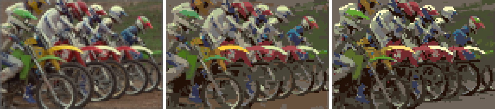

# Photo conversion audit

18 November 2026. Covers turning a photo into a chart: upload, the Convert settings,
`creator/generate.js`, `generate-worker.js`, `colour-utils.js`, the thread catalogue, and the
Stitch Tracker's own picture import. It follows
[photo-conversion-accuracy-review.md](photo-conversion-accuracy-review.md) and
[photo-conversion-accuracy-audit.md](photo-conversion-accuracy-audit.md) (October), and
re-measures everything after the October changes and the
[DMC colour calibration](dmc-colour-calibration.md). No app code is changed by this report.

## Summary

The October work fixed shrinking, the thread budget and confetti cleanup. Since then, two
things have moved: the thread colours were darkened, and the Convert controls became one
*Detail and tidiness* choice. Measured again on the same ten photos:

1. **One cleanup step does most of the remaining damage.** The *edge-shade fold*, built to
   remove blurry in-between shades around logos, changes **11% of every photo's stitches**
   (6 to 20%). Its code assumes photos are left alone, but with 24 threads and shading
   nearly every photo colour passes its tests. Turning it off for photos lowers the colour
   error from **5.32 to 4.77** and the boundary error from **7.23 to 6.15**, for about one
   point more confetti. This is the cheapest, largest accuracy gain available.
2. **"Fuzzy" has two causes, and they need different fixes.**
   - Each stitch is the average of the picture under it. A stitch that straddles an
     edge becomes an in-between colour, so outlines blur by up to a stitch. This is correct
     to the light, but it reads as soft.
   - The edge-shade fold then pushes some of those in-between stitches to one side, so the
     edges become blocky.

   *Sharpen details* does not help: it made every accuracy measure worse. A prototype "dominant
   colour" shrink makes each edge stitch take a side, and visibly sharpens outlines (see
   [Finding 5](#5-why-charts-look-fuzzy)).
3. **The thread range itself caps accuracy.** Even with all 525 DMC threads available, the
   nearest thread is on average ΔE 3.8 from the photo, and a quarter of stitches have no
   thread within ΔE 5. The gaps are muted mid-tones: greys, olives, browns and skin. This is
   why charts look muddier than the photo in those areas, and no setting can fix it. Blends
   of two threads close most of the gap (ΔE 3.8 to 1.4).
4. **Blend colours are worked out the old, darkening way.** A blend's colour is the average
   of its two threads' stored values, the same gamma-space averaging October removed from
   shrinking. For 13% of the blends the app can choose, the predicted colour is off by more
   than ΔE 2 (up to 7.4).
5. **Several assumptions are untested or false.** They are listed in
   [The assumptions the conversion makes](#the-assumptions-the-conversion-makes), with the
   evidence for each. The most important false ones:
   - the fold leaves photos alone;
   - the "detail" map finds flat areas (it marks 87% of a photo as detail);
   - the fabric colour does not matter (it is never passed to the conversion);
   - one random palette start is good enough (the default seed is among the worst of six
     tried).
6. **Compared with other tools**, the pipeline is more careful than any converter whose
   method is published. It leads on light-correct shrinking, perceptual colour matching,
   palette refinement, blends and stash-only charts. Two features it lacks are common
   elsewhere: choosing colours the chart must keep, by clicking the picture or picking
   threads, and a "most common colour" way of picking each stitch's colour.

## How this was checked

- **Code:** every path from a picture to stitches. That covers upload and shrinking
  (`useProjectIO.js`), the picture-type guess and presets (`useCreatorState.js`),
  `gridPixels`, the shared pipeline (`runCleanupPipeline` and `generate-worker.js`, which
  still mirror each other), the preview (`usePreview.js`), and the Tracker's
  `parseImagePattern` in `import-formats.js`.
- **Measurements:** the existing harness (`scripts/conversion-accuracy/`) runs the real
  worker in Node on ten standard photos at 100 stitches on the long side. New scripts are in
  [`scripts/conversion-accuracy/audit-2026-11/`](../scripts/conversion-accuracy/audit-2026-11/README.md).
  The measures are the same as October:

  | Measure | What it means |
  |---|---|
  | Colour error | Mean ΔE2000 per stitch against the photo's light-average under it. About 1 is just noticeable; over 5 is clearly a different colour. |
  | Viewed error | The same after blurring both by one stitch, roughly how the chart reads from arm's length. |
  | Boundary error | Colour error on strong boundaries only. |
  | Confetti | Stitches with no same-colour neighbour. |
  | Small patches | Stitches in same-colour patches of 1 to 3. |

- **Other tools:** web search plus the published documentation that could be reached. This
  session's network could not reach the WinStitch/MacStitch, PCStitch, mySewnet and KXStitch
  manuals directly, so those rows rely on search excerpts of their manuals and are marked as
  such.

**Limits of the measures.** They compare the chart with the photo *averaged per stitch*, in
the app's own thread colours. Two consequences:

- Any method that makes edges crisper scores worse by construction, so softness can't be
  judged from the numbers alone. The renders below are there for that.
- If the thread colours are wrong, the numbers can't tell. The catalogue is a calibrated
  approximation, not a measurement (see the calibration report).

## The pipeline today

```
upload (shrunk to 2000 x 2000 if larger, halving steps)
  -> picture-type guess (Graphic / Photo / Pixel art) sets the preset and Detail and tidiness step
  -> automatic "leave the background unstitched" if the outer border is one colour
  -> gridPixels: each stitch = light-correct average of the pixels under it     <- finding 5
     then brightness / contrast / saturation on the stitch colours
  -> [optional] Soften (median / Gaussian), at stitch size
  -> palette: k-means on real threads (one random start)                         <- finding 7
              -> drop near-duplicates -> add small, clearly different colours
  -> match each stitch: nearest thread by ΔE2000, Smooth blend (Atkinson at 50%),
     two-thread blends allowed when they are clearly nearer                      <- findings 3, 4
  -> fold rare colours (under 0.5% of stitches, unless they stand out)
  -> fold edge shades into their neighbours (Stitch Cleanup on)                  <- finding 1
  -> Reduce confetti (level 2), skipping patches on an outline
  -> [optional] keep look-alike colours apart
  -> enforce Threads (max) and the blend limit (12 recipes)
```

What a new user gets for a photo: 24 threads, *Balanced* (Smooth blend at 50%, Stitch
Cleanup on, Reduce confetti 2, Protect fine details on), blends on, Min stitches 0,
100 stitches on the long side.

## The assumptions the conversion makes

| # | Assumption | Where | Holds? | Evidence |
|---|---|---|---|---|
| A1 | The picture is sRGB | Browser canvas | Mostly | Browsers convert embedded profiles to sRGB when drawing to a canvas. Wide-gamut phone photos (Display P3) lose their most saturated colours, which rarely matter for thread. HEIC files only open where the browser can decode them (Safari); elsewhere the user gets "Couldn't read that image". |
| A2 | A stitch shows the light-average of the picture under it | `gridPixels`, `linearAreaDownscale` | Yes, physically | Correct as light. Perceptually it blurs edges: see finding 5. |
| A3 | Stitches are square, one full cross per pixel | Everywhere | Yes for Aida and evenweave over two | No support for non-square fabric counts, which some other programs offer. Rarely needed. |
| A4 | A thread's colour on screen is the catalogue RGB | `dmc-data.js` | Approximately | Calibrated against a scanned card (median ΔE 6.4 to it), not measured. Puts a floor under every accuracy number. |
| A5 | Two threads in one needle look like the average of their stored RGB values | `makeThreadBlend` | **No** | Strands side by side mix as light. The stored-value average is too dark: mean error ΔE 1.1, 13% over 2 (finding 4). |
| A6 | ΔE2000 under D65 is how different two colours look | `findSolid`, `findBest`, palette | Yes | Standard. Clustering uses OKLab and cluster centres are averaged in CIELAB; these agree closely enough. |
| A7 | The edge-shade fold leaves photos alone because their colours are not "minor and thin" | `mergeEdgeBlendColours` comment | **No** | With 24 threads and shading, most photo colours are under 5% of stitches and mostly lie along other colours. The fold changes 11% of stitches (finding 1). |
| A8 | The "detail" (saliency) map separates flat areas from detailed ones | `generateSaliencyMap` | **No** | Mean 0.81 on photos; only 13% of stitches count as flat (finding 6). Reduce confetti's larger flat-area patches and the confetti-aware shading therefore rarely act. |
| A9 | One random palette start is good enough | `quantizeConstrained`, seed 1337 | **Partly** | Colour error ranges from 5.21 to 5.34 over six seeds; 1337 gives 5.32 (finding 7). |
| A10 | Threads should go to the largest areas | k-means weights each pixel equally | **Partly** | Faces and small subjects get leftover threads. Carried over from October, still open (finding 8). |
| A11 | The fabric colour does not affect the conversion | Not passed to the pipeline | **No** | Areas of the picture that match the fabric are still stitched, unless they touch the border (finding 9). |
| A12 | Background = the border colour, within ΔE76 15 | `prepareConversionPixels` | Mostly | The only colour test still in ΔE76; elsewhere the pipeline uses ΔE2000. ΔE76 15 is a big step in neutrals and a small one in saturated colours. |
| A13 | Alpha under 128 means "not stitched" | `prepareConversionPixels` | Yes | Consistent across all paths. |
| A14 | Graphic when 85% of pixels are in eight colour groups and 60% of neighbours match exactly | `guessPictureType` | Yes | JPEG logos at quality 0.7 to 0.95 and flat graphics are all guessed correctly; all ten photos are guessed as photos. |
| A15 | The Tracker's picture import and the Creator's Convert give the same chart | `parseImagePattern` | **No** | It is a separate pipeline: full-strength shading, and no rare-colour fold, edge fold, confetti cleanup or thread limit (finding 10). |

## Findings

### 1. The edge-shade fold costs photos the most accuracy

`mergeEdgeBlendColours` was added for logos: shrinking a flat graphic blurs every edge, and
each blurry shade got its own thread. It only folds colours that are under 5% of the stitches
and lie mostly along other colours, on the assumption that photos don't have those. With a
24-thread photo palette and shading, they nearly all do.

| Photo | Stitches the fold changes | Threads it removes entirely |
|---|---|---|
| chelsea (cat) | 19.5% | 2 |
| kodim15 | 17.6% | 4 |
| kodim23 (parrots) | 12.6% | 2 |
| astronaut (portrait) | 12.5% | 4 |
| rocket | 6.1% | 1 |
| **mean of 10** | **11.2%** | **2.2** |

What each stage costs (ten photos, everything else at the Photo default):

| Configuration | Colour error | Viewed error | Boundary error | Confetti | Small patches |
|---|---|---|---|---|---|
| **Photo default (Balanced)** | 5.32 | 3.36 | 7.23 | 3.98% | 8.60% |
| Default without the edge-shade fold | **4.77** | **2.96** | **6.15** | 5.06% | 10.94% |
| Shading off, without the fold, Reduce confetti 2 | 4.70 | 3.12 | 6.05 | 4.86% | 9.94% |
| Shading on, Stitch Cleanup off | 4.57 | 2.68 | 5.72 | 12.64% | 23.73% |
| Plain matching (no shading, no cleanup) | 4.46 | 2.92 | 5.61 | 10.33% | 18.08% |
| More detail (Reduce confetti 0) | 5.18 | 3.12 | 6.88 | 9.03% | 17.14% |
| Tidier | 5.55 | 3.48 | 8.09 | 0.14% | 5.68% |
| Easiest to stitch | 5.91 | 4.02 | 9.11 | 0.10% | 1.10% |

*More detail* is shading plus the fold: the same shading with Stitch Cleanup off scores 4.57,
so the fold alone costs it 0.6. Without the fold, *Balanced* recovers about 60% of the gap to
plain matching's accuracy, and keeps about 80% of its confetti reduction (10.33% to 5.06%,
against 3.98% with the fold).


Left to right: photo at stitch size; Photo default; without the fold; shading off, without the
fold; plain matching. In the default, the white shuttle (right) breaks into black and white
blocks and the dark collar is blocked in. Without the fold, both follow the photo.



**Fix:** run the fold for Graphic and Pixel art only, or when shading is off and the palette
is small. The simplest version is a `foldEdgeShades` flag in `PICTURE_PRESETS` (on for
graphic, off for photo), passed through both pipelines. Then re-measure the photo steps and
update the figures in the `STITCH_STYLES` comment and in the step descriptions.

### 2. Shading earns its place only for arm's-length viewing

Once the fold is off, Smooth blend at 50% is nearly neutral: colour error 4.77 against 4.70
without shading, viewed error 2.96 against 3.12, with similar confetti. It still helps
gradients (skies, skin) look smooth from a distance, so keeping it in *Balanced* is
reasonable. It is not the source of the inaccuracy.

### 3. The thread range caps accuracy, and blends are the way round it

For each stitch of each photo, the nearest thread in the *whole* catalogue:

| | Mean distance | Stitches with no thread within ΔE 5 |
|---|---|---|
| Current (calibrated) DMC colours | 3.84 | 25.0% |
| Pre-calibration (community) colours | 4.26 | 31.4% |
| Current colours, with every allowed two-thread blend | 1.36 | not measured |

- **The calibration helped.** Photos sit closer to the darker, calibrated thread colours than
  to the old, lighter community values.
- **The colours with no close thread are muted mid-tones:** near-neutral greys (28% of them),
  yellow-olives (20%), muted reds and browns, and skin (17%). Their mean chroma is 18, against
  21 for all stitches. This matches what people see: brown dirt comes out grey-mauve, and
  olive foliage comes out flatter than the photo.
- **Blends close most of the gap, but are capped.** In a chart they only help a little
  (colour error 5.52 without blends, 5.32 with). Blends can only pair threads already in the
  24-thread palette, within ΔE 20 of each other. A blend is used only when the nearest solid
  thread is over ΔE 5 away and the blend is at least 3 nearer. And at most 12 blend recipes
  are kept.

  Worth measuring before changing: letting the palette step choose threads *as blend pairs*
  aimed at the photo's poorly-served colours, and relaxing the "3 nearer" margin.

### 4. Blend colours are mixed in gamma space

`makeThreadBlend` sets a blend's RGB to the average of the two threads' stored sRGB values,
then derives its Lab from that. Two strands side by side mix as light, which is lighter.
For all 18,174 thread pairs the app is allowed to blend (within ΔE 20):

- mean difference between the two models: ΔE 1.08;
- over ΔE 2: 13.1%; over ΔE 3: 4.4%;
- worst: 740 + 3771 (ΔE 7.4);
- the light model is lighter by 0.5 L* on average.

So the app picks blends for colours slightly darker than they really are, and shows blend
swatches too dark. The measurement harness already scores blends with the light model; only
the app uses the old one.

**Fix:** average the threads' linear values in `makeThreadBlend` (blend IDs and symbols do not
change). Then check the blend tests and `restoreStitch`, which rebuilds blend colours from
their parts.

### 5. Why charts look fuzzy

In the chart preview, the flat view draws stitches with `image-rendering: pixelated`, so the
preview itself is not blurring anything. The softness comes from the conversion:

- **Averaging.** A stitch that covers half a white collar and half a dark background becomes
  mid-grey, then the nearest thread to mid-grey. Every outline gains a one-stitch band of
  in-between colours. This is the light-correct answer, but the eye reads it as a soft edge.
- **Then blocky.** The edge-shade fold (finding 1) pushes some of those band stitches to one
  side and leaves others. The result is an edge that is both soft and jagged.
- ***Sharpen details* does not fix it.** It works before shrinking, so it brightens halos
  rather than choosing sides:

  | | Colour error | Viewed error | Boundary error |
  |---|---|---|---|
  | Photo default | 5.32 | 3.36 | 7.23 |
  | Sharpen details 0.5 | 5.45 | 3.52 | 7.55 |
  | Sharpen details 1.0 | 5.67 | 3.82 | 8.04 |

**Prototype: "dominant colour" shrink.** For each stitch, split the pixels under it into two
groups. If they are clearly different (ΔE over 12) and the larger covers at least 60%, the
stitch takes the larger group's colour; otherwise the average, as now. 16% of photo stitches
take a side. Tools such as cstitch offer this kind of choice ("Median" or "Mode" squaring).



Left to right: photo; light-average shrink; dominant-colour shrink. Both use shading off and
no fold. The right-hand chart has brighter whites and clearer helmets, wheels and number
plates. It scores worse (colour error 5.23 against 4.70, boundary error 7.84 against 6.05),
because the reference *is* the averaged photo. Whether stitchers prefer it needs people
looking at both, not this metric.

**Suggestion:** offer it as a *Crisp edges* option, on by default for Graphic, and try it on
Photo with a few real charts. It slots into `gridPixels` (`_averagedGridPixels`), so preview,
Generate and Compare options stay in step.

### 6. The detail map still treats almost every photo as detailed

`generateSaliencyMap` averages 0.81 on the ten photos; only 13% of stitches score under 0.25,
and on the six busiest photos it is 1 to 8%. Two features depend on it:

- Reduce confetti's larger patch size in flat areas (twice as big);
- Smooth blend's preference for a thread a neighbour already uses (`4 × (1 − detail)` ΔE;
  about 0.8 ΔE at the mean, so it rarely changes a choice).

October found raising the divisor alone did nothing. The map needs recalibrating at stitch
size (for example, normalising by the photo's own spread of local contrast rather than a fixed
40-grey step), or these two features should be dropped as inert. This becomes worth doing once
the fold is off for photos, because Reduce confetti then has more to work on.

### 7. The palette depends on a random start

`quantizeConstrained` uses one k-means++ start with a fixed seed (1337). Over six seeds on the
ten photos, colour error ranges from 5.21 to 5.34; the default seed gives 5.32. *Variation*
already exposes other seeds, but by hand.

**Fix:** run three to five starts and keep the palette with the lowest mapping error. This is
standard k-means practice and keeps the result repeatable. Palette choice is a small part of
generation time at 100 stitches, but should be timed on a 500 × 500 chart in the browser
before shipping.

### 8. Faces and small subjects still get leftover threads (open since October)

k-means gives each pixel one vote, so backgrounds and clothing win thread slots. October
measured the astronaut's face at ΔE 6.2 with 20 threads. Raising the Photo preset to 24
threads helped, but the palette is still chosen by area.

Other tools handle this by letting the user say which colours matter: cstitch lets you click
the picture to add colours, and WinStitch can import using a palette you saved.

**Suggestion:** a *Keep this colour* eyedropper in Convert. Clicking the picture reserves the
nearest thread before clustering, and the preview's change line shows the effect. This is
more predictable than automatic face detection, and also serves logos, where one brand colour
must be exact.

### 9. The fabric colour is ignored by the conversion

The Creator keeps a fabric colour (`fabricColour`), but it is never passed to the conversion. Two effects:

- **On white Aida,** white areas inside the picture (a shirt, a cloud) are stitched in
  white thread. Only background that touches the border is left unstitched.
- **On coloured fabric,** a pale background is still stitched unless it touches the border.
  Nothing tells the user that a dark fabric changes how the unstitched areas will look.

**Suggestion:** offer *Leave fabric-coloured areas unstitched*. Any stitch within a small
ΔE2000 of the fabric colour becomes unstitched, not just regions touching the border. Then
show it in the preview over the fabric colour. Treat this as a design choice for the user:
some stitchers want full coverage.

### 10. The Tracker's picture import is a second pipeline (open since October)

`parseImagePattern` (`import-formats.js`) shares `linearAreaDownscale`, `quantizeConstrained`
and the matching functions. It does not run:

- the rare-colour fold;
- the edge-shade fold;
- Reduce confetti;
- the thread and blend limits.

It also shades at full Atkinson strength, where Convert uses 50%. A picture opened straight in
the Tracker therefore gives a noisier chart than the same picture through Convert. Routing it
through `runCleanupPipeline` with the Photo or Graphic preset would remove the drift.

### 11. Smaller points

- **Skip background** (A12) uses ΔE76 with a threshold of 15; everything else uses ΔE2000.
  Switching it to ΔE2000 with an equivalent threshold (about 8 to 10) would treat neutrals and
  saturated backgrounds alike. Needs a migration for saved `bgTh` values.
- **Upload limit:** pictures over 2000 × 2000 are shrunk in halving steps (gamma-space). At
  500 stitches that is still 4 pixels per stitch, so the error is small. It is the one
  shrinking step left that does not average as light.
- **October's open items** are unchanged: the migration note for old cleanup settings, the
  symbol count with blends (now 27 symbols for 18 threads on average), and the browser tests
  not running in CI.

## Comparison with other tools

What each tool's published documentation says about turning a photo into a chart. Blank
means the documentation reached did not say.

| | stitchx | WinStitch / MacStitch | cstitch (open source) | KG-Chart | Stitch Fiddle | Pic2Pat / mySewnet |
|---|---|---|---|---|---|---|
| Photo vs graphic modes | Guessed automatically, three types, then four Detail and tidiness steps | Photo or Clip art; Photo turns on dithering¹ | No | | | |
| Colour count | Threads (max), with blends counted | Number of thread colours¹ | Number of colours, or "all nearest DMC" | Number of colours² | | Pic2Pat shows results by colour count³; mySewnet suggests an "optimal" count⁴ |
| Size from fabric | Fabric count and finished size | Cloth holes per inch and finished size¹ | Square size with a dimension helper | Chart size² | | |
| Shrinking | Light-correct average | | Median or most-common colour per square | | | |
| Colour matching | ΔE2000, k-means on real threads, palette refinement | | "Closest matching DMC colour" | DMC by default² | | Nearest thread in the chosen range⁴ |
| Dithering | Smooth blend (Atkinson 50%), Pattern blend (Bayer) | Dither (Photo) checkbox¹ | No | | | |
| Two-thread blends | Yes, automatic | | No | | | |
| Must-keep colours | No | Import with a saved palette (Premium)¹ | Click the picture to add colours | | | |
| Only threads you own | Stash-only | Saved palette (Premium)¹ | No | | | |
| Confetti cleanup | Automatic rare-colour fold, Reduce confetti | Per-colour counts to find strays (third-party report) | Replace rare colours | | | |
| Background | Automatic when the border is plain | Advises making it one colour before import¹ | | | Advises editing the picture first (Canva)⁵ | |
| Preview before committing | Live, with what changed | Advanced Import preview¹ | Compare colour choices | | | |

¹ Ursa Software user guides 2012–2023, via search excerpts. ² Third-party guide. ³ Forum
report. ⁴ mySewnet help, via search excerpt. ⁵ Stitch Fiddle's import help.

**Where stitchx is ahead:**
- light-correct shrinking;
- ΔE2000 matching with palette refinement;
- automatic blends;
- automatic background and picture-type detection;
- a live preview that explains each change.

None of the other tools' documentation describes anything comparable for the first three.

**Where others offer something stitchx doesn't:**
- user-chosen must-keep colours (finding 8);
- a most-common-colour way of choosing each stitch (finding 5).

General guidance on converters recommends 25 to 40 colours for photos and no dithering.
stitchx's 24-thread cap is at the low end of that. Its shading is gentle enough that
"no dithering" advice aimed at full-strength error diffusion doesn't really apply.

## Recommendations

In order of benefit for effort.

| # | Change | Effort | Expected effect | Risk |
|---|---|---|---|---|
| 1 | Don't run the edge-shade fold for photos (finding 1) | Small | Colour error 5.32 to 4.77, boundary 7.23 to 6.15; confetti +1 point | Changes every new photo chart; re-measure the style steps and update their text and the changelog |
| 2 | Mix blend colours as light (finding 4) | Small | Blend predictions right to within rounding; better blend choices | Blend swatches get slightly lighter in existing projects |
| 3 | Best of three to five palette starts (finding 7) | Small | About 0.1 lower colour error; less luck in the result | Generation time; time it on large charts |
| 4 | Route the Tracker's picture import through the shared pipeline (finding 10) | Medium | Same chart from either tool | Changes another tool's output |
| 5 | *Keep this colour* eyedropper (finding 8) | Medium | Faces, logos and key colours get their thread | UI design needed |
| 6 | *Crisp edges* (dominant-colour) option (finding 5) | Medium | Sharper outlines; worse on the averaged-photo metric | Needs people to compare real charts |
| 7 | *Leave fabric-coloured areas unstitched* (finding 9) | Medium | Less stitching, truer look on coloured fabric | Opt-in, so low |
| 8 | Recalibrate or remove the detail map (finding 6) | Medium | Makes two features do what they say | Needs measuring after 1 |
| 9 | Palette chosen with blends in mind, aimed at muted mid-tones (finding 3) | Large | Most of the remaining colour error is here | Research; more symbols |
| 10 | Photograph real thread beside a colour checker card | Outside code | Puts a measured floor under A4 | None |

Recommendations 1 to 3 need only small changes and can be checked with the scripts in
`scripts/conversion-accuracy/audit-2026-11/`. Recommendation 1 alone fixes the clearest
inaccuracy and part of the blocky look.

## Sources

- [MacStitch / WinStitch User Guide 2012](https://www.ursasoftware.com/help/2012_en/manual/manual.html),
  [Importing Pics (2012)](https://www.ursasoftware.com/help/2012_en/filemenu/page14/page14.html),
  [User Guide 2014](https://www.ursasoftware.com/help/2014_en/importexport/styled/page19.html),
  [The Import Wizard (2023)](https://ursasoftware.com/help/2023/TheImportWizard.html):
  search excerpts only; the site could not be fetched from this session.
- [cstitch documentation](https://cstitch.sourceforge.net/doc.shtml): read in full.
- [Stitch Fiddle: Import picture](https://www.stitchfiddle.com/en/help/1pej-wc93j/import-picture).
- [KG-Chart / StitchSketch blog](https://www.iktsoft.net/kgchart-en/blog/?page=14) and
  [KG-Chart Pro](https://www.mozusystems.com/products/kg-chart-pro/).
- [mySewnet Cross Stitcher: Choose Thread Colors](https://softwarehelp.mysewnet.com/MSM/120/CrossStitcher/Topics/Choose_Thread_Colors.htm)
  and [Cross Stitch Design Wizard](https://softwarehelp.mysewnet.com/MSW/100/CrossStitcher/Topics/PP3W_Cross_30_Pic_Wizard.htm):
  search excerpts only.
- [Photo to cross stitch pattern best settings](https://stitchpatternmaker.pages.dev/blog/photo-to-cross-stitch-pattern-best-settings)
  and [Lord Libidan: best cross stitch pattern software](https://lordlibidan.com/best-cross-stitch-pattern-software/):
  general guidance, third-party.
- [PCStitch vs WinStitch for photo conversion](https://omidsaffari.com/blog/pcstitch-vs-winstitch-for-photo-conversion):
  third-party and promotional; used only for the per-colour count note.
